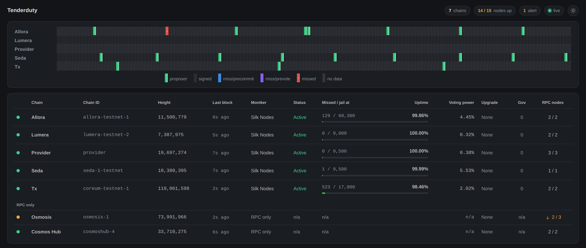
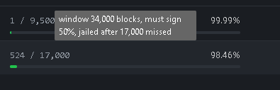
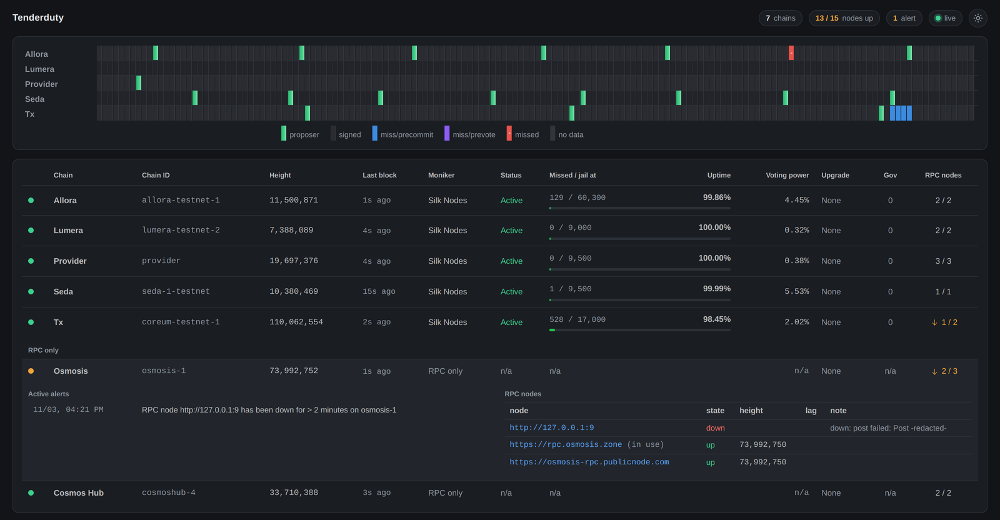
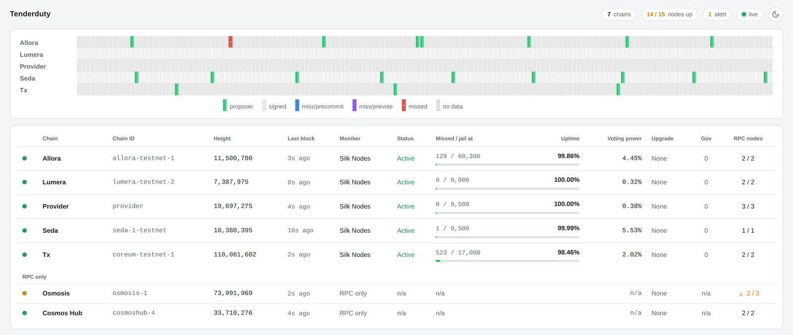
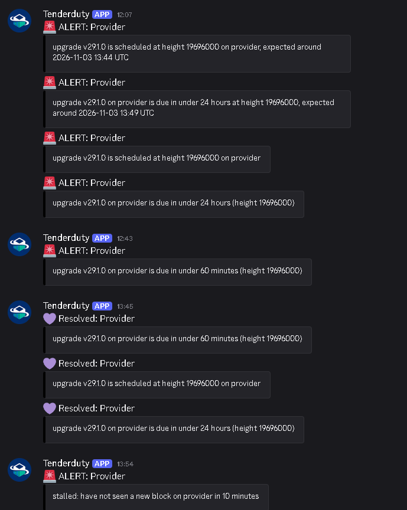

# TenderDuty v2

[](https://github.com/Silk-Nodes/tenderduty/actions/workflows/go.yml)
[](https://github.com/Silk-Nodes/tenderduty/actions/workflows/gosec.yml)
[](https://github.com/Silk-Nodes/tenderduty/actions/workflows/codeql.yml)
[](https://github.com/Silk-Nodes/tenderduty/actions/workflows/docker-publish.yml)

Tenderduty is a monitoring tool for Tendermint and CometBFT chains. Its primary function is to alert a validator if they are missing blocks, and it has many other features.

## About this fork

Tenderduty was written by [blockpane](https://github.com/blockpane), and v2 was a complete rewrite sponsored by the [Osmosis Grants Program](https://grants.osmosis.zone/). The upstream repository was archived in December 2024. Silk Nodes has run it every day since, across a large number of chains, and maintains this fork so it keeps working and keeps up with the ecosystem. Everything that makes tenderduty good was already there before this fork.

## What is new in this fork

🔀 **Height-aware node monitoring with automatic RPC failover.** All of a chain's nodes are probed together once a minute, their block heights compared, and the one with the highest height used. A node that goes down, falls more than `lag_blocks` behind, or stops delivering blocks over its websocket is replaced by the next best node within about a minute. Taking one node down for maintenance no longer stops monitoring for that chain.

⬆️ **Upgrade alerts.** A notice the moment an upgrade proposal enters its voting period, with the planned height read from the proposal, which is usually days of warning; then one when the plan is scheduled in the x/upgrade module, one when it is under 24 hours away and one when it is under 60 minutes away, with the time estimated from recent block times. A vote can close less than an hour before the upgrade height, so the proposal notice is the one that gives time to prepare. If the chain halts at its upgrade height, the stalled alert says so. One resolve once the upgrade is through.

🔑 **Consensus addresses get the full set of checks.** A chain configured with a valcons address used to get signing checks only. The operator is now looked up in the bonded set, so moniker, jail state, stake, governance and voting power work for it too; consumer chains without a staking module keep the old behaviour.

📡 **RPC-only chains.** Leave out `valoper_address` for a chain where you only run RPC nodes and you still get node health, stalled chain and upgrade alerts for it. They are listed below the validators on the dashboard.

🗳️ **Governance reminders.** A reminder when a proposal is in its voting period and the validator has not voted, and a second one under 24 hours before the end. Resolved once the vote is cast.

📊 **Voting power changes.** A notice when the delegated stake moves by more than a set percentage between two refreshes.

💬 **Readable chat messages.** Discord, Slack and Telegram alerts carry a heading with an emoji for the kind of alert (governance, upgrade, missed blocks, node down, stalled chain, voting power, validator inactive), the chain, a colour for the severity, and the detail broken into lines instead of one long sentence. Resolves are green. Discord posts that hit the webhook rate limit are retried instead of lost.

🔕 **Per-channel severity threshold.** PagerDuty defaults to `warning`, so the new notices (info) go to Discord, Telegram and Slack but do not page anyone unless you raise their priority.

🖥️ **Dashboard.** Last block age, voting power, upgrade countdown, unvoted proposal count, per-node height and lag, and a panel per chain listing the active alerts and the node table with each RPC URL as a link. Missed blocks are shown against the count that gets the validator jailed, taken from the chain's slashing parameters, with a bar that runs from green to red as the allowance is used. State is pushed every minute as well as on every block, a new browser connection gets the current state at once, and the theme choice is remembered (`?theme=dark` or `?theme=light` pins it). The page is served with a Content-Security-Policy and no inline scripts.

✅ **Alerts that never resolved now do.** Upstream, the percentage-missed alert sent its clear as a new alarm, the stalled alert waited for a condition that never came, the "no RPC endpoints" alarm cleared whenever any node answered, and a node that was down at restart never alerted or cleared. Each left a PagerDuty incident open until someone closed it by hand. All four now resolve on their own.

🛠️ **Up to date.** cosmos-sdk 0.53, CometBFT 0.38 and Go 1.26. The module path is `github.com/Silk-Nodes/tenderduty/v2` with no replace directives, so `go install github.com/Silk-Nodes/tenderduty/v2@latest` works, and there is a Makefile and a systemd guide. Dependabot keeps patch releases coming, and `make vulncheck` runs govulncheck in CI on every push and weekly, failing on any advisory the code reaches that [docs/security-exceptions.md](docs/security-exceptions.md) does not accept.

🩹 **Other fixes.** The dashboard feed dropped about half of its updates, so the block grid moved in jumps; it now gets every one-second update and a stale browser tab no longer holds the others up. Slack alerts are de-duplicated like the other channels, a crash when an RPC URL could not be parsed, a healthcheck ping with no timeout, a dashboard that only updated when a block arrived, and a node-down alert whose text began with an empty severity.

🔒 **Hardened after a security audit.** The dashboard serves only its own routes (a dependency used to add `/debug/vars`, which printed the command line), sends no CORS header, accepts websocket connections from its own origin only, and can be bound to one address with `listen_address`. Webhook URLs and bot tokens no longer appear in logs when a send fails. A single bad answer from an RPC node (a short consensus key, a missing slashing parameter, a moniker that is not valid UTF-8, a frame or response of any size) used to end the process for every chain; each of those paths is now checked or bounded, and a panic in one chain's loop restarts that loop instead of the monitor. Alerts are de-duplicated per chain, so a jailing on one chain no longer silences the same alert on another, and chat markup in proposal titles and monikers is escaped.

The new alert types are opt-in per chain: `upgrade_enabled`, `governance_enabled` and `voting_power_enabled` under `alerts`. See [docs/config.md](docs/config.md).

## Screenshots

The dashboard, dark theme. Validators are listed first with the block grid above them, then the chains that are
monitored for their RPC nodes and upgrades only. The health dot on the left turns amber for an open alert and red
for jailed, tombstoned or stalled.



Hovering the missed count shows the chain's signing window, the minimum share that must be signed and the number of
missed blocks that gets the validator jailed.



Clicking a chain opens its panel: the active alerts with their start time, the node table with height, lag and
the reason a node was marked down, and any proposals in their voting period. Each node URL is a link. This one is
a chain monitored for its RPC nodes only, with one node down and the next one in use.



The light theme, chosen with the toggle in the top right or pinned with `?theme=light`.



Upgrade notices as they arrive in Discord, from a testnet upgrade: the plan is announced, then the 24 hour and
60 minute reminders, then one resolve once the chain is past the upgrade height. The stalled alert below it is
the chain halting at the upgrade height until enough validators had upgraded.



## Documentation

The [documentation](docs/README.md) is a work-in-progress.

## Runtime options:

```
$ tenderduty -h
Usage of tenderduty:
  version
    	print the version, commit and Go toolchain the binary was built with
  -example-config
    	print the an example config.yml and exit
  -f string
    	configuration file to use (default "config.yml")
  -state string
    	file for storing state between restarts (default ".tenderduty-state.json")
  -cc string
    	directory containing additional chain specific configurations (default "chains.d")
```

## Installing

Detailed installation info is in the [installation doc.](docs/install.md)

30 second quickstart if you already have Docker installed:

```
mkdir tenderduty && cd tenderduty
docker run --rm ghcr.io/silk-nodes/tenderduty:latest -example-config >config.yml
# edit config.yml and add chains, notification methods etc.
docker run -d --name tenderduty -p "8888:8888" -p "28686:28686" --restart unless-stopped -v $(pwd)/config.yml:/var/lib/tenderduty/config.yml ghcr.io/silk-nodes/tenderduty:latest
docker logs -f --tail 20 tenderduty
```


## Split Configuration

For validators with many chains, chain specific configuration may be split into additional files and placed into the directory "chains.d".

This directory can be changed with the -cc option

The user friendly chain label will be taken from the name of the file.  

For example:

```
chains.d/Juno.yml -> Juno
chains.d/Lum Network.yml -> Lum Network
```

Configuration inside chains.d/Network.yml will be the YAML contents without the chain label.

For example start directly with:

```
chain_id: demo-1
    valoper_address: demovaloper...
```

## Contributions

Contributions are welcome, please open pull requests against the `main` branch.

